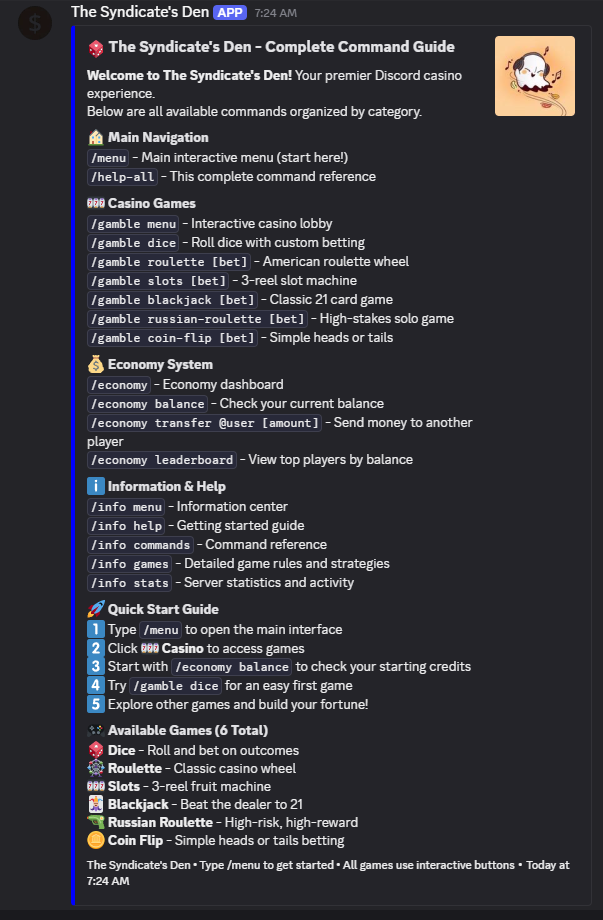
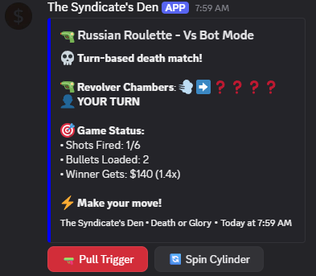
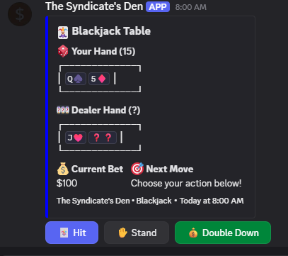

# 🎰 The Syndicate's Den - Discord Casino Bot


A sophisticated Discord bot that transforms your server into a virtual casino, featuring interactive games, comprehensive economy system, and professional UI design. Built with Java and JDA (Java Discord API) for maximum performance and reliability.

## 📸 Bot in Action

<div align="center">

| Complete Command Guide | Russian Roulette Game | Blackjack Table |
|:----------------------:|:---------------------:|:---------------:|
|  |  |  |
| *Comprehensive help menu with all commands* | *High-stakes Russian Roulette interface* | *Interactive blackjack with real-time gameplay* |

</div>

> 🎯 **See more screenshots and UI examples in the [`screenshots/`](screenshots/) folder**

## 🌟 Key Features

### 🎮 Six Complete Casino Games
- **🎲 Dice** - Interactive dice game with multiple betting options and real-time animations
- **🎡 Roulette** - Full American roulette with 38-number wheel and comprehensive betting system
- **🎰 Slots** - Three-reel slot machine with varied payouts and special combinations
- **🃏 Blackjack** - Complete 21 implementation with splitting, doubling, and optimal dealer AI
- **🔫 Russian Roulette** - High-stakes game with user-selectable risk levels and two game modes
- **🪙 Coin Flip** - Simple heads/tails betting with instant results

### 💼 Professional Bot Architecture
- **🔗 Modern Slash Commands** - Full Discord Slash Command integration with autocomplete
- **🎨 Interactive UI** - Button-based interfaces with comprehensive navigation
- **📊 Real-time Feedback** - Animated game sequences and instant balance updates
- **💾 Persistent Storage** - SQLite database with transaction safety and data integrity
- **🔧 Robust Error Handling** - Comprehensive exception management and user feedback

### 🏦 Advanced Economy System
- **💰 User Balances** - Individual user wallets with transaction history
- **💸 Transfer System** - Secure player-to-player money transfers
- **🏆 Leaderboards** - Dynamic rankings and wealth displays
- **🎯 Risk Management** - Intelligent betting limits and balance validation

## 🚀 Technical Implementation

### Architecture Overview
```
📁 src/main/java/com/syndicate/bot/
├── 🎮 commands/
│   ├── gambling/    # Game implementations
│   ├── economy/     # Financial operations
│   └── information/ # Help and statistics
├── 🎲 game/         # Game session management
├── 🔗 listeners/    # Event handling and UI
└── 💾 database/     # Data persistence layer
```

### Core Technologies
- **Java 17+** with modern features and performance optimizations
- **JDA 5.0.0** for Discord API integration
- **SQLite** for lightweight, serverless database operations
- **Maven** for dependency management and build automation
- **SLF4J + Logback** for comprehensive logging and debugging

### Code Quality Standards
- **Clean Architecture** - Separation of concerns with distinct layers
- **SOLID Principles** - Maintainable and extensible codebase
- **Error Safety** - Comprehensive exception handling and validation
- **Performance Optimization** - Efficient database queries and memory management

## 🎯 Quick Start Guide

### Prerequisites
- **Java Development Kit 17+**
- **Maven 3.6+**
- **Discord Bot Token** (from Discord Developer Portal)

### Installation Steps

1. **Clone Repository**
   ```bash
   git clone https://github.com/yourusername/syndicate-den-bot.git
   cd syndicate-den-bot
   ```

2. **Configure Environment**
   Create `.env` file in project root:
   ```env
   BOT_TOKEN=your_discord_bot_token
   ```

3. **Launch Bot**
   
   **Windows (Double-click or command line):**
   ```cmd
   run.bat
   ```
   
   **Manual (All platforms):**
   ```bash
   mvn clean package
   java -jar target/syndicate-den-bot.jar
   ```

4. **Verify Installation**
   - Bot appears online in Discord
   - Use `/menu` to open the main interface
   - Test with `/help-all` for complete command reference

## 📋 Command Reference

### 🏠 Main Navigation
- `/menu` - Interactive main menu with full navigation
- `/help-all` - Comprehensive command guide and quick start

### 🎰 Casino Games
- `/gamble menu` - Interactive casino lobby
- `/gamble dice` - Advanced dice game with betting strategies
- `/gamble roulette [bet]` - American roulette with full betting board
- `/gamble slots [bet]` - Three-reel slot machine
- `/gamble blackjack [bet]` - Professional blackjack implementation
- `/gamble russian-roulette [bet]` - High-stakes risk/reward game
- `/gamble coin-flip [bet]` - Simple probability betting

### 💰 Economy Management
- `/economy` - Financial dashboard with balance overview
- `/economy balance` - Detailed balance information
- `/economy transfer @user [amount]` - Secure money transfers
- `/economy leaderboard` - Server wealth rankings

### ℹ️ Information Center
- `/info menu` - Information hub with help resources
- `/info help` - Getting started guide
- `/info commands` - Complete command reference
- `/info games` - Detailed game rules and strategies
- `/info stats` - Server statistics and activity data

## 🎮 Game Showcase

### 🎲 Advanced Dice System
- **Multiple Bet Types**: High/Low, Lucky 7, Snake Eyes, Boxcars
- **Dynamic Payouts**: From 2x to 30x based on probability
- **Interactive Interface**: Real-time dice rolling animations
- **Strategic Betting**: Risk/reward optimization with house edge display

### 🎡 Professional Roulette
- **Complete Wheel**: American roulette with 0 and 00
- **Full Betting Board**: Single numbers, colors, odd/even, dozens
- **Visual Feedback**: Animated wheel spinning and ball landing
- **Authentic Payouts**: True casino odds from 2x to 36x

### 🔫 Russian Roulette Innovation
- **Variable Risk**: 1-5 bullets with mathematical multiplier scaling
- **Two Game Modes**: Solo climbing multipliers vs. turn-based bot play
- **Quit Anytime**: Strategic exit with 5% house edge
- **Dramatic Presentation**: Cylinder spinning animations and suspense

## 💡 Development Highlights

### Advanced Game Logic
- **Mathematically Accurate**: All odds calculated using probability theory
- **House Edge Management**: Configurable edge percentages for profitability
- **Session Management**: Robust game state handling with timeout protection
- **Balance Safety**: Transaction atomicity with rollback capabilities

### User Experience Design
- **Intuitive Navigation**: Hierarchical menu system with breadcrumbs
- **Visual Consistency**: Professional color scheme and emoji usage
- **Responsive Interface**: Button states and loading indicators
- **Error Prevention**: Input validation and clear feedback messages

### Performance Engineering
- **Efficient Database**: Optimized SQLite queries with connection pooling
- **Memory Management**: Proper resource cleanup and garbage collection
- **Concurrent Safety**: Thread-safe operations and race condition prevention
- **Scalable Architecture**: Modular design supporting feature expansion

## 🔧 Configuration Options

### Environment Variables
```env
# Required
BOT_TOKEN=your_discord_bot_token

# Optional Customization
DATABASE_NAME=syndicate_den.db
INITIAL_USER_BALANCE=1000
LOG_LEVEL=INFO
```

### Advanced Settings
The bot includes intelligent defaults for all casino parameters, including:
- Game-specific house edges
- Maximum bet limits per game
- User balance initialization
- Transaction logging levels

## 📊 Database Schema

### User Management
- **User Balances**: Persistent virtual currency storage
- **Transaction History**: Complete audit trail of all financial operations
- **Game Statistics**: Individual player performance tracking

### System Data
- **Configuration Storage**: Runtime settings and feature flags
- **Error Logging**: Comprehensive error tracking and debugging data
- **Performance Metrics**: Response times and usage analytics

## 🛡️ Security & Reliability

### Data Protection
- **Token Security**: Environment-based configuration with .gitignore protection
- **SQL Injection Prevention**: Parameterized queries and input sanitization
- **Error Isolation**: Graceful degradation without data corruption

### Testing & Validation
- **Input Validation**: Comprehensive parameter checking and bounds enforcement
- **Error Recovery**: Automatic retry mechanisms and fallback procedures
- **Database Integrity**: Transaction safety with automatic rollback on failure

## 🚀 Deployment Ready

### Production Features
- **Startup Scripts**: Cross-platform launch automation
- **Dependency Management**: Automated build and dependency resolution
- **Logging System**: Configurable logging with file rotation
- **Health Monitoring**: Built-in status checking and error reporting

### Scalability Considerations
- **Modular Design**: Easy feature addition and modification
- **Database Optimization**: Efficient queries and indexing strategy
- **Memory Efficiency**: Optimal resource utilization and cleanup

## 📈 Skills Demonstrated

### Backend Development
- **Java Enterprise Patterns** - Service layer architecture and dependency injection
- **Database Design** - Schema optimization and query performance
- **API Integration** - Discord JDA implementation with event-driven architecture
- **Error Handling** - Comprehensive exception management and recovery

### Software Engineering
- **Clean Code** - SOLID principles and maintainable architecture
- **Testing Strategy** - Input validation and edge case handling
- **Documentation** - Clear code comments and API documentation
- **Version Control** - Git workflow with meaningful commit history

### Game Development
- **Mathematical Modeling** - Probability calculations and payout algorithms
- **State Management** - Complex game session handling
- **User Interface** - Interactive Discord UI with button navigation
- **Real-time Systems** - Immediate feedback and animation systems

## ⚠️ Important Notes

- **Virtual Currency Only**: All transactions use virtual credits with no real-world value
- **Entertainment Purpose**: Designed for fun and educational use only
- **Responsible Gaming**: Built-in safeguards and balance limits

## 📞 Professional Contact

This project demonstrates proficiency in:
- **Enterprise Java Development**
- **Discord Bot Architecture** 
- **Database Design & Management**
- **Interactive UI Development**
- **Mathematical Algorithm Implementation**
- **Production-Ready Software Delivery**

---

<div align="center">

**🎰 The Syndicate's Den - Professional Discord Casino Bot**

*Showcasing advanced Java development and interactive gaming systems*


</div> 